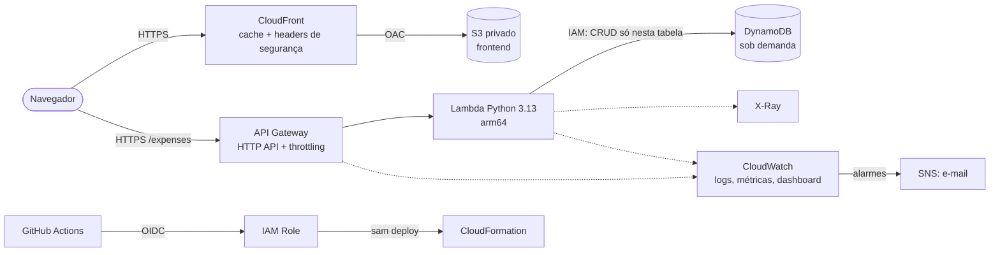

# API Serverless Escalável na AWS

[](https://github.com/Gxstein/serverless-api-aws/actions/workflows/ci.yml)
[](https://github.com/Gxstein/serverless-api-aws/actions/workflows/deploy.yml)

API REST de controle de despesas pessoais **sem servidor para gerenciar**: o código roda no **AWS Lambda**, as rotas ficam no **Amazon API Gateway (HTTP API)**, os dados no **DynamoDB** e o site estático num **S3 privado** entregue pelo **CloudFront** com HTTPS. Toda a infraestrutura é código (**AWS SAM / CloudFormation**) e cada merge na `main` é testado e publicado pelo **GitHub Actions** com autenticação **OIDC**.

O foco do projeto são três vantagens da nuvem:

- **Escalabilidade**: o Lambda cria novas execuções sozinho conforme a demanda, e o DynamoDB sob demanda acompanha sem configurar capacidade.
- **Custo por uso (pay-as-you-go)**: sem tráfego, o custo fica perto de zero.
- **Agilidade**: um `git push` testa, valida e publica API e frontend em poucos minutos.

## Arquitetura



Detalhes em [docs/arquitetura.md](docs/arquitetura.md).

## Endpoints

| Método | Rota | Descrição |
|---|---|---|
| `GET` | `/expenses` | Lista despesas (filtro opcional `?category=`) |
| `POST` | `/expenses` | Cria despesa |
| `GET` | `/expenses/summary` | Total geral e por categoria |
| `GET` | `/expenses/{id}` | Busca uma despesa |
| `DELETE` | `/expenses/{id}` | Remove uma despesa |

```bash
curl -X POST "$API_URL/expenses" \
  -H "Content-Type: application/json" \
  -d '{"description": "Almoço", "amount": 32.90, "category": "alimentacao", "date": "2026-10-05"}'
```

Categorias aceitas: `alimentacao`, `transporte`, `moradia`, `lazer`, `saude`, `educacao`, `outros`.

## O que cada parte faz

| Caminho | Para quê |
|---|---|
| `template.yaml` | Infraestrutura da aplicação (SAM): tabela, API, função, frontend, alarmes e dashboard |
| `src/expenses/app.py` | Código do Lambda: roteamento, validação e acesso ao DynamoDB |
| `tests/unit/` | Testes com `pytest` e `moto` (DynamoDB simulado, sem custo) |
| `frontend/` | Site estático (HTML, CSS e JavaScript puro) que consome a API |
| `loadtest/load-test.js` | Teste de carga com k6 |
| `deploy/github-oidc.yaml` | Acesso do GitHub Actions à AWS: provedor OIDC, roles e bucket de artefatos |
| `events/` | Eventos de exemplo para `sam local invoke` |
| `.github/workflows/` | `ci`: testes e validação · `deploy`: build, deploy e publicação do frontend |

## Segurança

- **Menor privilégio**: a função só pode ler e escrever na própria tabela (`DynamoDBCrudPolicy`).
- **Bucket privado**: o S3 bloqueia acesso público e só aceita leitura vinda desta distribuição do CloudFront (**Origin Access Control**); requisições sem HTTPS são negadas.
- **HTTPS em tudo**: CloudFront redireciona HTTP para HTTPS e aplica a política gerenciada de *security headers*.
- **Throttling** no API Gateway (100 req/s, rajada de 200) limita abuso e custo.
- **Criptografia em repouso** no DynamoDB e no S3; **backup contínuo** (Point-in-Time Recovery) na tabela.
- **Deploy sem chaves**: o GitHub assume uma role via OIDC, só a partir da branch `main`, e só pode *passar* a role de execução do CloudFormation, sem criar recursos diretamente.

## Observabilidade

- Logs em **JSON** do Lambda e *access logs* do API Gateway no CloudWatch (14 dias)
- Rastreamento com **AWS X-Ray** em cada invocação
- **Dashboard** com requisições, erros 4xx/5xx, latência p50/p95/p99, duração e concorrência do Lambda e consumo do DynamoDB
- **Alarmes** por e-mail para erros do Lambda, *throttling* e respostas 5xx

## Custos

Tudo aqui é cobrado por uso. Com pouco tráfego, o custo mensal fica perto de **US$ 0**, porque Lambda, CloudFront, DynamoDB e CloudWatch têm cotas gratuitas permanentes. Estimativa para **1 milhão de requisições por mês** em `us-east-1`:

| Serviço | Aproximado |
|---|---|
| API Gateway HTTP API | US$ 1,00 |
| Lambda (256 MB, ~50 ms) | US$ 0,00 (dentro da cota gratuita) |
| DynamoDB sob demanda | menos de US$ 1,00 |
| CloudFront, S3, CloudWatch | centavos |

Mais detalhes em [docs/custos.md](docs/custos.md).

## Como executar

### Pré-requisitos

- Conta AWS e AWS CLI v2 configurada
- [AWS SAM CLI](https://docs.aws.amazon.com/serverless-application-model/latest/developerguide/install-sam-cli.html)
- Python 3.13

### Testes locais

```bash
pip install -r tests/requirements.txt
pytest
```

### Deploy manual

```bash
sam build
sam deploy --parameter-overrides AlarmEmail=voce@exemplo.com
```

Confirme o e-mail do SNS para receber os alarmes. As URLs da API e do frontend aparecem nos *outputs* do deploy. Para publicar o frontend na mão:

```bash
API_URL=$(aws cloudformation describe-stacks --stack-name serverless-api-aws \
  --query "Stacks[0].Outputs[?OutputKey=='ApiUrl'].OutputValue" --output text)
BUCKET=$(aws cloudformation describe-stacks --stack-name serverless-api-aws \
  --query "Stacks[0].Outputs[?OutputKey=='FrontendBucketName'].OutputValue" --output text)

printf 'window.APP_CONFIG = { apiUrl: "%s" };\n' "$API_URL" > frontend/config.js
aws s3 sync frontend/ "s3://$BUCKET/" --delete
```

## CI/CD

| Workflow | Quando roda | O que faz |
|---|---|---|
| `ci.yml` | Todo PR e push na `main` | `pytest`, `sam validate --lint`, `cfn-lint` e `sam build` |
| `deploy.yml` | Push na `main` | Testes, `sam deploy`, publicação do frontend no S3, invalidação do cache do CloudFront e *smoke test* |

Configuração (uma vez):

```bash
aws cloudformation deploy \
  --template-file deploy/github-oidc.yaml \
  --stack-name serverless-api-aws-cicd \
  --capabilities CAPABILITY_NAMED_IAM
```

Depois, em **Settings > Secrets and variables > Actions > Variables**:

| Variável | Valor |
|---|---|
| `AWS_ROLE_ARN` | output `DeployRoleArn` |
| `SAM_ARTIFACTS_BUCKET` | output `ArtifactsBucketName` |
| `CFN_EXECUTION_ROLE_ARN` | output `CloudFormationExecutionRoleArn` |
| `ALARM_EMAIL` | seu e-mail |
| `AWS_REGION` | `us-east-1` |
| `ALLOWED_ORIGIN` | opcional: URL do CloudFront, para fechar o CORS |

Sem `AWS_ROLE_ARN`, o workflow de deploy é pulado e só o `ci` roda.

## Teste de carga

```bash
k6 run -e API_URL="$API_URL" loadtest/load-test.js
```

Sobe de 0 a 50 usuários virtuais criando e lendo despesas. Durante o teste, o dashboard mostra o Lambda aumentando a concorrência sozinho. Como rodar e o que observar: [docs/teste-de-carga.md](docs/teste-de-carga.md).

## Remover tudo

```bash
BUCKET=$(aws cloudformation describe-stacks --stack-name serverless-api-aws \
  --query "Stacks[0].Outputs[?OutputKey=='FrontendBucketName'].OutputValue" --output text)
aws s3 rm "s3://$BUCKET" --recursive
sam delete --stack-name serverless-api-aws
```

## Próximos passos

- Autenticação com Amazon Cognito (JWT authorizer no HTTP API)
- Índice secundário (GSI) por mês para substituir o `Scan`
- Domínio próprio com Route 53 e certificado do ACM
